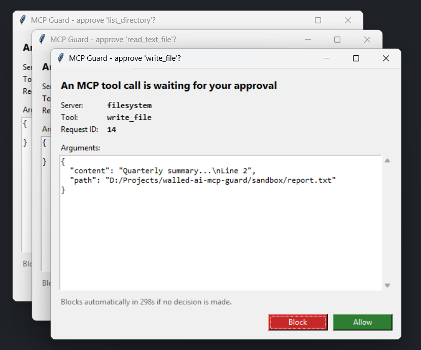
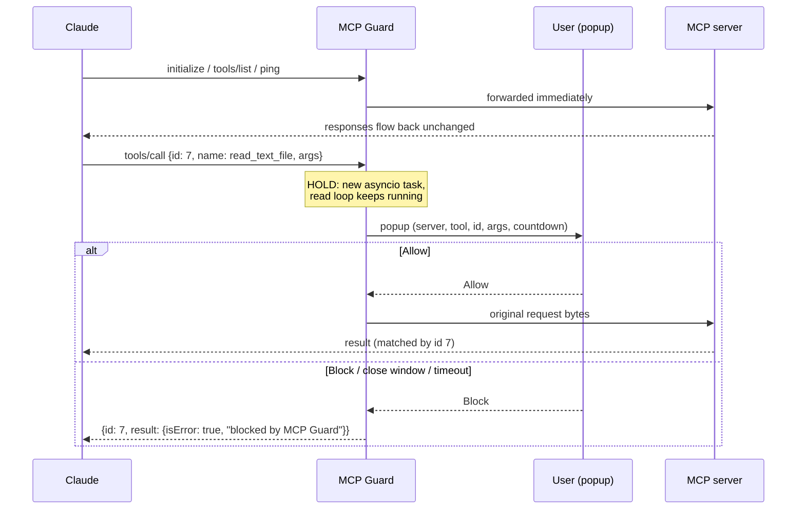

# MCP Guard

**A Python firewall for the Model Context Protocol.** MCP Guard sits between Claude (Desktop and Web)
and your MCP servers. It holds every tool call in an always-on-top popup until you click **Allow** or **Block**.



> **Demo video:** _add link here_ · Built for the Walled AI take-home assignment.

---

## Contents

1. [What it does](#what-it-does)
2. [Architecture](#architecture)
3. [How interception works](#how-interception-works)
4. [Design decisions](#design-decisions)
5. [Installation](#installation)
6. [Using it with Claude Desktop](#using-it-with-claude-desktop)
7. [Using it with Claude Web](#using-it-with-claude-web)
8. [Configuration reference](#configuration-reference)
9. [Security and reliability](#security-and-reliability)
10. [Testing](#testing)
11. [Project layout](#project-layout)
12. [Limitations and future work](#limitations-and-future-work)

---

## What it does

| Requirement | How MCP Guard does it |
|---|---|
| Monitor MCP requests from Claude Desktop and Claude Web | Every JSON-RPC message is parsed and logged. Tool calls are captured with server, tool name, request id and arguments |
| Confirmation popup on top of other windows | One always-on-top Tkinter window per pending call, showing the server, tool, id and pretty-printed arguments |
| Allow / Block | **Allow** forwards the original request unchanged. **Block** returns an MCP tool error (`isError: true`), and the server never sees the call |
| Keep requests pending until the user decides | Each call waits in its own asyncio task. Other traffic and further calls keep flowing |
| Multiple simultaneous requests | Independent popups, answered in any order and matched back by JSON-RPC id |
| Background operation | Launched automatically by Claude Desktop. A system-tray shield shows the status (green = idle, amber = pending) |
| Termination, failures, errors | Fails closed: timeout, crash, closing the window or shutdown all mean **Block** |

Verified end to end in **real Claude Desktop** (Windows, Microsoft Store build) and **real claude.ai** (custom
connector through a Cloudflare tunnel), using the official `@modelcontextprotocol/server-filesystem` server.

---

## Architecture

MCP Guard has one interception core and two front ends, one for each Claude client:

```
                     ┌──────────────────────────── MCP Guard (Python) ─────────────────────────────┐
Claude Desktop ─stdio─▶ app/main.py ──┐                                                               │
                     │                ▼                                                               │
                     │          StdioProxy (app/proxy.py) ── tools/call? ── Approver.decide() ──┐    │
                     │                ▲      everything else: forward                          │    │
Claude Web ─HTTPS─▶ tunnel ─▶ McpGateway (app/gateway.py)                                       ▼    │
                     │        one session = one StdioProxy                     TkinterApprover popup  │
                     │                                                         + tray icon           │
                     └───────────────────────────────┬────────────────────────────────────────────────┘
                                                     │ stdio (approved calls only)
                                                     ▼
                                    real MCP server, e.g. filesystem (sandbox only)
```

### Why two front ends?

- **Claude Desktop** launches local MCP servers itself and talks to them over **stdio**: newline-delimited
  JSON-RPC 2.0 on stdin/stdout. We register MCP Guard in `claude_desktop_config.json` *in place of* the real
  server. Claude launches MCP Guard, and MCP Guard launches the real server. That's a man-in-the-middle by
  configuration, with no packet sniffing or code injection.
- **Claude Web** can't launch programs. It only connects to **remote** MCP servers over HTTPS ("custom
  connectors"), and the requests come from Anthropic's cloud. So MCP Guard also serves MCP's
  **Streamable HTTP** transport (`--http`), exposed through a tunnel. Each web session gets its own guarded
  backend, and calls go through the same popup.

### Threads

```
main thread    Tk mainloop: TkinterApprover owns every popup window; polls a queue every 50 ms
asyncio thread StdioProxy / McpGateway: all protocol I/O, one task per pending tool call
stdin thread   blocking reads of Claude's stdin (asyncio can't read stdin reliably on Windows)
tray thread    pystray's OS message loop
```

Threads never touch each other's objects. `ApprovalBridge` connects asyncio to Tk with a thread-safe
`queue.Queue` one way and `loop.call_soon_threadsafe(future.set_result, decision)` the other way.

---

## How interception works



Key rules in `app/proxy.py`:

- **Only `tools/call` is held.** `initialize`, `tools/list`, notifications and `ping` pass through untouched;
  blocking them would just break the session.
- **The read loop never awaits an approval**, so one open popup can't stall other requests.
- **Allow forwards the original bytes**, so nothing is re-serialized or altered.
- **Block answers the client directly.** The server never sees the request. The reply is a normal tool result
  with `isError: true`, as the MCP spec defines for tool-execution errors, so the model can read it and explain it.
- **Cancellation:** `notifications/cancelled` for a held call cancels its task and closes its popup, and no
  response is sent, as the spec requires.

---

## Design decisions

| Decision | Why |
|---|---|
| Proxy rather than sniffing | stdio is a private pipe between two processes, with no network traffic to capture. Being the process Claude launches is the only reliable interception point |
| Intercept only `tools/call` | That's where side effects happen. Everything else is session setup and discovery |
| Pluggable `Approver` interface | The proxy only calls `await approver.decide(request)`. Popup, console and policy approvers are swappable, and tests use the policy approver |
| One asyncio task per call | The work is I/O-bound (pipes plus a human). Tasks are cheap, and writes to Claude are a single write+flush, so messages can't interleave |
| Tk on the main thread | Tk must stay on the thread that created it. The asyncio side moves to a worker thread instead |
| No MCP SDK | The proxy only needs JSON-RPC framing and a few MCP methods. It doesn't implement a server |
| Fail closed everywhere | A missing decision must never become an implicit Allow |

---

## Installation

Requirements: **Python 3.10+** (tested with 3.14), **Node.js 18+** (for the filesystem MCP server via `npx`),
and Windows 10/11 (also works on macOS/Linux with a desktop for the popup).

```bash
git clone https://github.com/yesubabu7/walled-ai-mcp-guard.git
cd walled-ai-mcp-guard
python -m venv .venv
.venv\Scripts\activate            # macOS/Linux: source .venv/bin/activate
pip install -r requirements.txt   # aiohttp (web gateway), pystray + Pillow (tray icon)
```

The filesystem server may only access `sandbox/`, which ships with a sample `notes.txt`. For a Block demo,
add a dummy secrets file, e.g. `sandbox/.env` (gitignored).

Quick check without Claude (each call opens a popup):

```bash
python scripts/test_client.py demo        # one session: initialize, tools/list, two tool calls
python scripts/concurrent_demo.py         # three simultaneous calls + a ping answered instantly
```

---

## Using it with Claude Desktop

**1. Install the entry.** `scripts/claude_config.py` finds Claude Desktop's config file, **backs it up** to
`backups/` (which is gitignored), and adds or removes **only** its own `mcpServers` entry. All other settings are
kept. Quit Claude Desktop completely (tray icon → Quit) first, because it rewrites this file while running.

```bash
python scripts/claude_config.py show        # dry run: prints current and proposed mcpServers
python scripts/claude_config.py install     # backup + add "filesystem-guarded"
```

The entry it adds:

```json
"mcpServers": {
  "filesystem-guarded": {
    "command": "C:\\path\\to\\walled-ai-mcp-guard\\.venv\\Scripts\\python.exe",
    "args": ["C:\\path\\to\\walled-ai-mcp-guard\\app\\main.py", "--server", "filesystem"]
  }
}
```

**2. Restart Claude Desktop.** Ask something like *"Using filesystem-guarded, read
`<repo>\sandbox\notes.txt`"*. A popup appears; Allow or Block.

**Config file location** (the script checks all of these):

| Install type | Path |
|---|---|
| Microsoft Store, newer builds | `%LOCALAPPDATA%\Claude-Data\claude_<id>\claude_desktop_config.json` |
| Microsoft Store, older builds | `%LOCALAPPDATA%\Packages\Claude_<id>\LocalCache\Roaming\Claude\claude_desktop_config.json` |
| Classic installer / macOS | `%APPDATA%\Claude\…` / `~/Library/Application Support/Claude/…` |

**To remove it:** `python scripts/claude_config.py uninstall` removes only our entry. `restore` puts back the newest
backup; prefer `uninstall`, because a restore also rolls back any Claude preferences that changed since the backup.

---

## Using it with Claude Web

```bash
python app/main.py --server filesystem --http --port 8765
#   logs: Claude Web connector URL: https://<your-tunnel-host>/mcp/<token>
#   (the token is generated once and stored in config/gateway_token.txt, which is gitignored)

winget install --id Cloudflare.cloudflared         # once (or ngrok, or any HTTPS tunnel)
cloudflared tunnel --url http://127.0.0.1:8765     # prints https://<random>.trycloudflare.com
```

In claude.ai, go to **Settings → Connectors → Add custom connector**. Use the URL
`https://<random>.trycloudflare.com/mcp/<token>` and leave the OAuth fields empty. Then turn the connector on in a
chat (the **+** menu → Connectors). claude.ai has its own tool-permission prompt; MCP Guard's popup is an
**independent** second layer that works even if the client-side prompt is turned off.

Test the gateway without claude.ai:
`python scripts/http_client.py http://127.0.0.1:8765/mcp/<token> read_text_file "{\"path\": \"notes.txt\"}"`

### Gateway protocol details (MCP Streamable HTTP, spec 2025-06-18)

- `POST /mcp/<token>` carries one JSON-RPC message.
  - **Requests** get a `text/event-stream` response with the result. While a popup is open, an SSE keep-alive
    comment is sent every 15 s so proxies and clients don't time out.
  - **Notifications** get `202`.
- `initialize` creates a session and returns its id in the `Mcp-Session-Id` header. An unknown session id gets
  `404`, which tells the client to start a new session.
- `DELETE` ends a session. Idle sessions are cleaned up after 30 min. `GET` returns `405`, since the
  server-to-client stream is optional.
- Every request is logged with the token **redacted** (`HTTP POST /mcp/<token> -> 200 (ua=Claude-User)`).

---

## Configuration reference

`config/servers.json` defines the backends MCP Guard can launch. `{python}` and `{root}` are replaced with
the current interpreter and the project folder.

```json
"filesystem": {
  "command": "npx",
  "args": ["-y", "@modelcontextprotocol/server-filesystem", "{root}/sandbox"],
  "ignore_client_roots": true
}
```

| Option | Default | Meaning |
|---|---|---|
| `--server NAME` | required | Backend from `servers.json` |
| `--approver popup\|console\|policy` | `popup` | Tkinter popup, terminal prompt, or static rules (`--allow`, `--block`, `--default`) |
| `--approval-timeout SEC` | `300` | Undecided calls are **blocked** after this many seconds |
| `--no-tray` | off | Hide the tray icon |
| `--http --port --host --token --allow-origin` | | Claude Web gateway options |
| `ignore_client_roots` (servers.json) | `false` | Stop clients from changing the server's allowed directories (see below) |

To guard another server (GitHub, a database…), add it to `servers.json` and register a second Claude Desktop
entry with `--server <name>`.

---

## Security and reliability

**Fails closed:** an Allow only happens on an explicit click.

| Situation | Result |
|---|---|
| Block button, closing the window, Escape | Block (keyboard focus starts on Block) |
| No decision within `--approval-timeout` | Block, and the popup closes |
| Approver crashes, or no display available | Block, or MCP Guard refuses to start; it never falls back to allowing |
| MCP Guard quits (tray menu, Ctrl+C) with calls pending | All pending calls are blocked |

**Requests can't sneak past:**

- **Unparseable lines** are rejected, never forwarded, because they might hide a tool call.
- **JSON-RPC batches** containing `tools/call` are rejected.
- **A `tools/call` sent as a notification** (no id) is dropped.
- **Duplicate pending ids** are rejected. Numeric `7` and string `"7"` are tracked separately.

**MCP Roots pinning (a real issue found during testing):** Claude Desktop's Code sessions advertise the
*roots* capability and send their own working folder. The filesystem server then **replaced** its configured
`sandbox` with that folder, so the client could widen the server's access. With `ignore_client_roots`, MCP Guard
removes `roots` from the client's `initialize` and drops `notifications/roots/list_changed`, so the server keeps
its configured directory. This was verified in Claude Desktop.

**Protocol hygiene:** stdout is reserved for JSON-RPC. MCP Guard keeps the real stream for protocol messages and
points `sys.stdout` at stderr, and non-JSON output from the backend is dropped. Logs go to `logs/proxy.log`
and stderr (which Claude Desktop captures).

**Gateway:**

- **Token:** a secret URL token, compared in constant time; a wrong token gets `404`.
- **Local only:** it binds to `127.0.0.1`, so the tunnel is the only way in.
- **Origin check:** foreign browser `Origin`s get `403`.
- **Isolation:** each session has its own backend process.
- **Disconnects:** when a client disconnects, its pending call is cancelled and the popup withdrawn.

**Lifecycle:** when Claude closes our stdin, MCP Guard cancels pending calls, closes the backend's stdin politely,
waits up to 5 s, then kills it. If the backend dies, the session ends cleanly instead of hanging.

---

## Testing

```bash
pip install -r requirements-dev.txt
python -m pytest -v            # 41 tests, ~20 s
```

| Suite | Tests | Covers |
|---|---|---|
| `test_interception.py` | 11 | Allow, Block, blocked by default, traffic flowing while a call waits, 3 simultaneous calls run in parallel, `7` vs `"7"`, cancellation, timeout, batches, bad JSON, clean exit with pending calls |
| `test_tk_approver.py` | 14 | Thread bridge without a display (simultaneous calls, timeout, a late click after shutdown); real Tk popups: details shown, always on top, Allow, Block, X = Block, two popups at once, timeout, shutdown, pending count |
| `test_gateway.py` | 11 | HTTP sessions, Allow/Block over SSE and JSON, wrong token, foreign Origin, batches, simultaneous calls, session isolation, keep-alives, disconnects, DELETE, GET 405 |
| `test_roots.py` | 2 | Roots pinning on vs. transparent pass-through |
| `test_tray.py` | 3 | Icon images, pending count, tooltip |

The end-to-end tests start the real proxy as a separate process in front of `examples/demo_server.py`, a tiny
MCP server whose `slow_echo` tool makes timing tests deterministic. Popup tests click the real buttons
programmatically and are skipped when no display is available.

---

## Project layout

```
app/
  main.py          CLI: config loading, run modes (stdio / --http), thread setup
  proxy.py         StdioProxy: forwarding, tools/call interception, roots pinning, lifecycle
  approval.py      Approver interface, ToolCallRequest, PolicyApprover, ConsoleApprover
  tk_approver.py   Tkinter popups + ApprovalBridge (asyncio <-> Tk thread hand-off)
  gateway.py       Streamable HTTP gateway for Claude Web
  tray.py          System-tray icon
  logger.py        File + stderr logging (never stdout)
config/servers.json   Backend MCP servers
scripts/
  claude_config.py    Safe install/uninstall/restore of the Claude Desktop entry
  test_client.py      Scripted MCP session over stdio
  concurrent_demo.py  Simultaneous-calls demo
  http_client.py      Scripted MCP session over HTTP (Claude Web path)
examples/demo_server.py  Minimal MCP server used by tests
tests/              41 pytest tests
sandbox/notes.txt   Demo file the filesystem server may read
```

---

## Limitations and future work

- **Coverage:** only servers routed through MCP Guard are protected. An unguarded entry added to Claude's config
  bypasses it. A watcher that flags unguarded entries would close this gap.
- **No GET stream:** the HTTP gateway offers no server-to-client stream, so server-initiated notifications (e.g.
  `tools/list_changed`) are dropped. Quick tunnels change hostname on restart; a named tunnel keeps a stable URL.
- **Granularity:** decisions are per call. Natural next steps are "always allow this tool", argument rules (e.g.
  block any path containing `.env`), and guarding `resources/read` as well.
- **Logging:** a structured JSON-lines audit log of decisions, with redaction of sensitive arguments.
